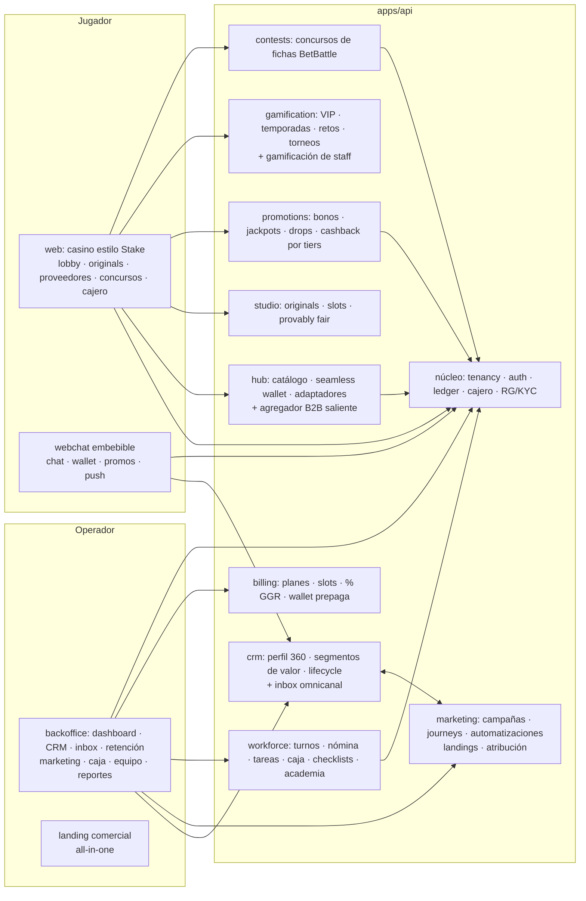

# Infinite Abyss — Arquitectura del all-in-one

Infinite Abyss es **una sola plataforma** para operar un negocio de iGaming completo: casino estilo Stake con juegos propios y de proveedores, agregador B2B, CRM omnicanal, retención y marketing, gestión del equipo (turnos, caja, tareas) con gamificación real, concursos de fichas y facturación a operadores. No se vende como "un casino": se vende como **el sistema operativo del operador**.

Este documento fija qué entra, de dónde sale cada pieza, qué se mejora y en qué orden se construye. Lo concreto del dominio sigue viviendo en [architecture.md](architecture.md), [modules.md](modules.md), [integration.md](integration.md) y [contracts.md](contracts.md).

## 1. Principios

1. **Un solo ledger.** Todo movimiento de dinero (depósitos, apuestas, bonos, cashback, premios de concursos, nómina) pasa por el ledger de doble partida en `bigint` de la base. Nada mueve saldo por fuera ni "edita" un saldo.
2. **Multi-operador desde el día uno.** Todo lleva `operatorId`; marca, dominio, moneda y módulos activos son configuración del operador (white-label).
3. **Módulos con límites claros.** Cada capacidad es un módulo (`apps/api/src/modules/<módulo>`) con `domain` / `application` / `infrastructure`, se comunica por `EventBus` y puertos, y se activa por operador y por plan (feature flags). Nada de god objects.
4. **Integraciones por puerto/adaptador.** Proveedores de juegos, agregadores, canales de mensajería, PSP, KYC, feeds deportivos y OCR son adaptadores intercambiables, nunca `if/case` por marca ni scraping de paneles ajenos.
5. **Idempotencia y conciliación en todo lo que toca dinero**: clave de idempotencia por operación, lock por jugador, rollback con tombstone, conciliación diaria que solo reporta, y "resultado incierto queda retenido hasta que lo resuelve una persona".
6. **Seguridad por defecto**: firmas HMAC con timestamp + nonce en toda entrada externa, secretos solo en `.env`/gestor de secretos (nunca en git), auditoría de toda acción de backoffice, juego responsable y KYC/AML integrados.
7. **Reutilizar y mejorar, no reescribir por gusto.** Lo bueno de los sistemas existentes se porta (a TypeScript, sobre esta base); lo frágil se rediseña.

## 2. De dónde sale cada pieza

Los sistemas de origen se conservan intactos y solo sirven de referencia (no forman parte de este repo).

| Sistema de origen | Qué es en realidad | Qué aporta a Infinite Abyss |
|---|---|---|
| **Grand Sovereign / Nymfo** (base de este repo) | Plataforma iGaming multi-operador en TS | Ledger, cajero (Passimpay, Wompi), juego responsable, Studios (originals provably fair + 3 slots), Hub de proveedores, promociones, CRM básico, marketing, gamificación de jugador, backoffice |
| **Magik CRM** (fork más nuevo de Beast) | CRM omnicanal para agencias de casino | Inbox en tiempo real, funnels, automatizaciones visuales con outbox, motor de retención por eventos, segmentos de valor y lifecycle, VIP/temporadas/retos, campañas masivas, landings con atribución, webchat embebible con wallet y push, bot IA con atajo de FAQ, OCR de comprobantes, SLA de agentes |
| **Beast CRM** | CRM genérico (origen de Magik) | Webhooks salientes firmados con DLQ y replay, cobro B2B por slot/usuario con wallet prepaga, promociones interactivas (cofres), kanban con enlace público, agenda/reservas, academia (LMS), motor de automatización con nodo LLM |
| **Strike IQ** | Back-office del staff de un holding de agencias | Turnos y fichaje, horas/deuda y nómina, kanban con cronómetro atribuido, cierre de turno y cuadre de caja, checklists, avisos con acuse, academia, ranking de cajeros, SLA de chat, cashback por tiers, sugerencias IA por jugador |
| **Astroclub** | Casino white-label con red de agentes y capa multi-agregador | Adaptadores reales de API-Matic y API-Slots, firma anti-replay (timestamp + nonce + hash del cuerpo), allowlist de IP, free spins en el launch, inventario por proveedor, multisaldo y wager por peso de juego, conciliación ledger↔rondas y cuadre diario, outbox de webhooks, jerarquía de agentes y venta de fichas |
| **BetBattle** | Concursos de fichas con bolsa cerrada sobre eventos deportivos | Motor de concursos (Quick, Torneo por fases, Amigos con código), reparto por resto mayor, máquina de estados con CHECKs, invariantes contables, confirmación de resultados con dos fuentes, reglas anti multi-cuenta, hold de retiro y redención en circuito cerrado |

## 3. Mapa de módulos

### 3.1 Casino (experiencia estilo Stake)

- **Estructura y UX al nivel de Stake** (barra lateral con categorías, lobby con carruseles, originals destacados, apuestas en vivo de otros jugadores, panel de fairness, chat de sala, VIP visible, cajero cripto y fiat), con **marca y arte propios**: no se usa el nombre, logo ni recursos de Stake.
- **Originals propios** de Studios (dice, plinko, roulette, crash en vivo, mines, blackjack, 3 slots) con provably fair y RTP por operador. Se suman: Limbo, Keno, HiLo, Wheel, Tower y Video Poker.
- **Proveedores**: todo juego externo entra por el Hub (§3.2). Pragmatic y los demás proveedores contratados se conectan rellenando su adaptador con las credenciales y el contrato que entregue cada uno.

### 3.2 Hub y agregador

Base: módulo `hub` (catálogo por operador, seamless wallet `balance/bet/win/rollback` con HMAC, idempotencia con fingerprint, tombstones, wallet saliente B2B). Mejoras:

1. **Adaptadores reales**: API-Matic y API-Slots portados de Astroclub; esqueletos directos de **Pragmatic Play**, **Evolution** y genérico listos para rellenar con el contrato de cada proveedor (endpoint de launch, firma, callbacks y mapeo `refund`→rollback con referencia).
2. **Solo juegos oficiales**: el inventario marca `official`/`clone` y los clones quedan bloqueados por defecto (riesgo de licencia).
3. **Anti-replay en todas las entradas**: firma sobre `timestamp\nnonce\nMÉTODO\npath\nsha256(body)`, ventana de ±300 s, memoria de nonces, allowlist de IP y verificación sesión↔jugador.
4. **Free spins** en el launch y gestionables, con ganancias que pasan a bono.
5. **Conciliación** ledger↔rondas y cuadre diario con alertas (solo reporta, nunca corrige).
6. **Callbacks de wallet en un proceso propio** (pool y SLO aparte) para que un pico del lobby no tumbe las apuestas.

### 3.3 CRM e inbox omnicanal

Base: módulo `crm` (perfil 360, segmentos, timeline, tickets). Se porta de Magik/Beast:

- **Inbox en tiempo real**: chats por canal, asignación a agentes, funnels, respuestas rápidas, notas internas, etiquetas.
- **Canales**: **WhatsApp Cloud API oficial** (no QR no oficial), Telegram, Instagram/Messenger, email y el webchat propio.
- **Webchat embebible** de un solo `<script>`: chat, login del jugador, depósito/retiro dentro del chat, promociones interactivas (cofres) y push por suscriptor.
- **Identidad única del jugador**: el contacto de chat y el jugador del casino son la misma persona (sin el cruce frágil por `admin_id` de los sistemas actuales).
- **Bot IA de soporte y caja** con atajo de FAQs por embeddings antes del LLM, herramientas acotadas (consultar saldo, crear jugador, aplicar bono) y consumo medido. Toda acción con dinero pasa por el ledger y queda auditada.
- **SLA de respuesta y presencia de agentes**: demoras escaladas, pausas, inactividad e incidentes.

#### Abyss Flows: constructor de flujos propio (tipo n8n)

Una herramienta visual para que el operador diseñe, sin programar, cómo responden los bots (webchat, caja, soporte) y las automatizaciones. Reemplaza el n8n externo que usan los sistemas actuales ("Obrero principal") y parte del motor `Automation::Flow` de Magik y del bot cajero de RoboBeast.

- **Canvas de nodos** con versiones (borrador → publicado → historial) y ejecución paso a paso inspeccionable.
- **Disparadores**: mensaje entrante (por canal), evento del casino (registro, depósito, retiro, inactividad), horario y webhook firmado.
- **Nodos**: condición, esperar, responder (texto, botones, plantillas), clasificar intención con IA, FAQ por embeddings, leer comprobante (OCR), consultar saldo, crear jugador, aplicar bono, pasar a un agente humano, HTTP saliente firmado y subflujo.
- **Dinero seguro por diseño**: los nodos que mueven dinero llaman al ledger con clave de idempotencia y, si el resultado es incierto (p. ej. comprobante dudoso), el flujo queda **en espera de aprobación humana**. Nunca hay acreditación directa desde un prompt.
- **Ejecución robusta**: outbox idempotente, reintentos con backoff, anti-loop, límites por conversación y registro auditable de cada paso.
- **Plantillas listas**: bienvenida + registro, depósito con comprobante, retiro, recuperación de inactivos y soporte con IA.

### 3.4 Retención, marketing y automatización

Base: módulos `marketing` y `promotions`. Se porta:

- **Motor de retención por eventos**: ingesta firmada, reglas evento → condiciones → acción con prioridad y cooldown.
- **Segmentos de valor configurables** (ultra VIP, estrella, ballena, masa, oneshot) y **lifecycle** (activo, en riesgo, dormido, perdido).
- **Automatizaciones visuales** (grafo versionado, ejecución paso a paso, outbox idempotente, anti-loop, chequeos de inactividad, nodo LLM).
- **Campañas masivas** con pacing, variables, recurrencia, deduplicación y reintentos idempotentes.
- **Cashback por tiers** con presets y jobs asíncronos idempotentes.
- **Landings con versiones y atribución** (pixel, conversión, ROAS por cohorte).

### 3.5 Workforce: equipo, caja y gamificación de staff

Módulo nuevo (`workforce`), portado de Strike IQ y mejorado:

- **Turnos y fichaje** (normal, extra, franco, recuperación; pausas), horas objetivo y deuda, **nómina** (valor hora, extras ×1,5, ajustes, aguinaldo, reparto entre marcas) con asiento en el ledger.
- **Tareas** en kanban con cronómetro atribuido, checklists de turno, avisos con acuse obligatorio, resumen programado.
- **Caja**: cierre de turno y diario, cuadre por moneda.
- **Academia** (cursos y videos) para cajeros, agentes y afiliados.
- **Gamificación real del staff** (lo que Strike solo dibujaba): XP por operación atendida, SLA cumplido y calidad (no solo volumen), ligas semanales, insignias e historial persistente, ranking con tendencia y premios pagados por el ledger.

### 3.6 Gamificación del jugador

Base: módulo `gamification` (VIP con puntos y rakeback, misiones, logros, racha, rueda diaria, torneos en tiempo real). Se suman temporadas, retos y curva de XP de Magik, y minijuegos de marca (raspadita, trivia) con backend real.

### 3.7 Concursos de fichas (BetBattle)

Módulo nuevo (`contests`) sobre el ledger:

- Entrada en dinero real → **escrow propio** (`CONTEST_ESCROW`); fichas en tablas separadas que **nunca** tocan el ledger de dinero.
- Modos Rápido, Torneo por fases y Amigos (código de sala). Reparto por resto mayor; rake a `RAKE_REVENUE`; invariantes de bolsa cerrada verificados en la conciliación.
- **Un puerto de feed deportivo** (cuotas y resultados) con confirmación de dos fuentes + gracia; los casos ambiguos van a revisión humana.
- Requiere contratar un feed (por ejemplo LSports o Sportradar) y un **dictamen legal por jurisdicción** antes de abrirlo con dinero real.

### 3.8 Billing B2B

Módulo nuevo (`billing`) para cobrar a los operadores que usan la plataforma: planes (CRM, casino externo, casino interno), cobro por línea/agente y % de GGR, wallet prepaga y snapshot de suscripción. Las funcionalidades se habilitan por plan con feature flags.

## 4. Qué no se porta (y por qué)

| Práctica de los sistemas de origen | Por qué no | Alternativa en Infinite Abyss |
|---|---|---|
| Cloaking de landings para evadir la revisión de anuncios | Viola políticas de Meta; riesgo de bloqueo de cuentas | Landings limpias con atribución |
| WhatsApp no oficial (QR, humanizer, warmer anti-baneo) | Viola los términos de WhatsApp; líneas inestables | WhatsApp Cloud API oficial |
| Scraping/login por cookie a paneles de casino ajenos | Frágil y sin garantías contables | Casino propio + adaptadores con contrato |
| Juegos "clone" de agregadores | Riesgo de licencia con los proveedores | Solo catálogo oficial |
| Secretos y tokens en el repositorio | Filtración de credenciales | `.env` y gestor de secretos; CI con escaneo |
| Saldo editable sin ledger, montos en texto/float | Descuadres imposibles de auditar | Ledger de doble partida en `bigint` |

## 5. Roadmap por PRs

Cada fase es un PR independiente contra `main`, con CI en verde (typecheck, migraciones y pruebas).

| # | PR | Contenido | Fuente principal |
|---|---|---|---|
| 1 | Arquitectura (este documento) | Visión, mapa de módulos, roadmap | Todos |
| 2 | Marca Infinite Abyss + shell estilo Stake | Rebrand, layout del jugador (sidebar, header, lobby, carruseles, apuestas en vivo), tema oscuro, responsive | Grand Sovereign |
| 2b | Backoffice estilo dashboard | Marca y layout pro del backoffice: tarjetas KPI con tendencia, resumen financiero (hoy, histórico, neto), actividad reciente, turnos activos, navegación por secciones | Grand Sovereign, Strike |
| 3 | Hub: agregadores reales | Adaptadores API-Matic y API-Slots, firma anti-replay, allowlist, free spins, inventario oficial/clone, conciliación de rondas; esqueletos Pragmatic/Evolution documentados para rellenar | Astroclub |
| 4 | Más originals | Limbo, Keno, HiLo, Wheel, Tower y Video Poker con provably fair y pruebas de RTP | Grand Sovereign |
| 5 | Inbox omnicanal + webchat | Chats, agentes, funnels, WhatsApp Cloud API, Telegram, widget embebible con wallet y push | Magik, Beast |
| 6 | Abyss Flows + retención | Constructor de flujos tipo n8n para bots (webchat, caja, soporte) con nodos de IA, OCR y dinero con aprobación humana; motor de reglas, segmentos de valor, lifecycle, campañas masivas, cashback por tiers | Magik, RoboBeast, Strike |
| 7 | Workforce | Turnos, nómina, tareas, caja, checklists, avisos, academia | Strike, Beast |
| 8 | Gamificación de staff y jugador | XP/ligas/insignias de staff, temporadas y retos de jugador, minijuegos | Strike, Magik |
| 9 | Concursos de fichas | Módulo `contests`, escrow, reparto, puerto de feed deportivo (con feed simulado) | BetBattle |
| 10 | Billing B2B y webhooks salientes | Planes, slots, % GGR, wallet prepaga, webhooks firmados con DLQ | Beast |
| 11 | Landing comercial | Página que vende el all-in-one por capacidades y planes | — |
| 12 | Producción | Observabilidad (OpenTelemetry, métricas de negocio, SLO del wallet), IaC, backups, runbooks | Astroclub, Magik |

## 6. Pendientes del negocio

- **Contratos de proveedores** (Pragmatic y demás): endpoint de launch, firma, callbacks y credenciales de staging de cada uno, para rellenar sus adaptadores.
- **Licencia de juego** y jurisdicciones objetivo: definen KYC, límites, juego responsable y si los concursos de fichas se pueden abrir.
- **Feed deportivo** para los concursos.
- **Derechos sobre el código de origen**: usar como referencia código de Magik, Beast, Strike, Astroclub o BetBattle requiere ser titular o tener permiso de sus dueños.
