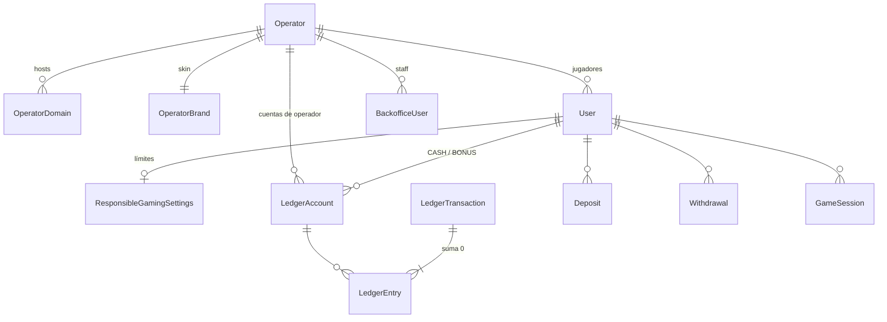
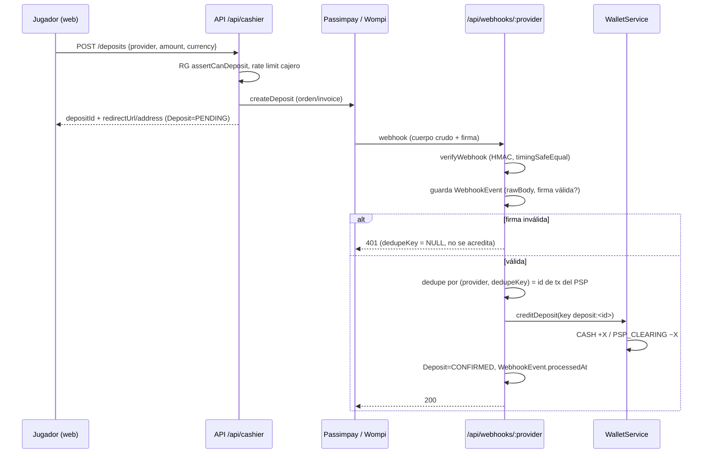
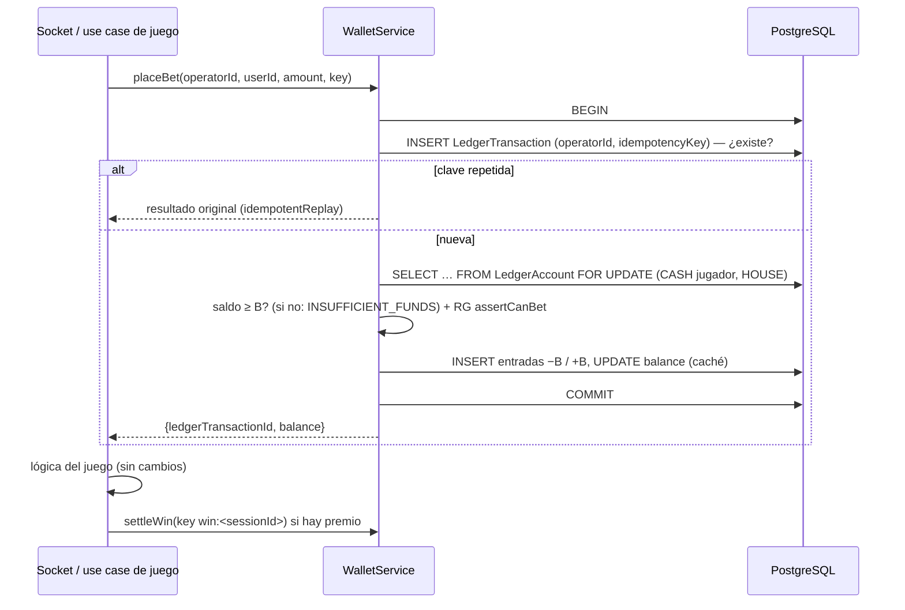
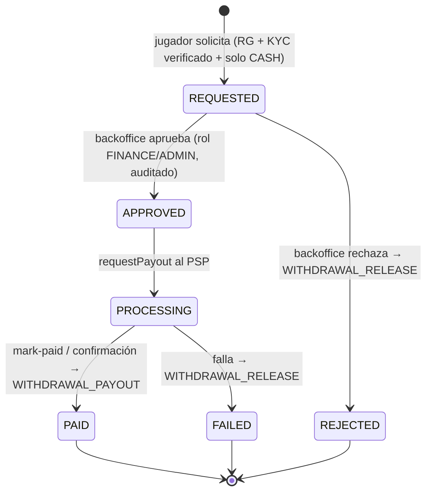

# Nymfo Casino — Arquitectura (Fase 1)

Documento para desarrolladores. Fuentes de verdad: `apps/api/prisma/schema.prisma` (migración `20261020190000_init`) y [contracts.md](contracts.md) (contratos REST/socket e interfaces). Si algo difiere, mandan esos dos archivos.

La api sigue arquitectura limpia: `domain` (entidades, contratos, dinero) → `application` (casos de uso y servicios) → `infrastructure` (Prisma, HTTP, sockets, PSP).

## 1. Modelo de dominio

- **Operator**: tenant. `slug`, `name`, `status` (ACTIVE/SUSPENDED/DISABLED), `defaultCurrency`, `currencies[]`, `limits` (JSON validado con zod) y la configuración de fichas (`chipsEnabled`, `chipMinorUnitsPerChip`).
- **OperatorDomain**: hosts (únicos globalmente) que resuelven a un operador; uno puede ser `isPrimary`.
- **OperatorBrand** (1:1): `displayName`, `logoUrl`, `faviconUrl`, `colors` (primary, secondary, accent, background, surface, text), `fontFamily` y `legal` (términos, privacidad, texto de juego responsable, licencia, edad mínima). La web lo convierte en variables CSS.
- **Jugadores (`User`)**: pertenecen a un operador; email único **por operador** (`emailNormalized`), contraseña con bcryptjs, `status`, `currency`, `isDemo`, `kycStatus` (NONE/PENDING/VERIFIED/REJECTED).
- **Juego responsable (`ResponsibleGamingSettings`)**: límites de depósito y pérdida (diario/semanal/mensual), límite de sesión, autoexclusión (temporal o permanente), cool-off y aumentos pendientes con periodo de enfriamiento. `IResponsibleGamingPolicy` se comprueba en depósito (`assertCanDeposit`), apuesta (`assertCanBet`) y retiro (`assertCanWithdraw`, que además exige KYC verificado).
- **Backoffice (`BackofficeUser`)**: roles `PLATFORM_ADMIN` (sin operador), `OPERATOR_ADMIN`, `OPERATOR_SUPPORT`, `OPERATOR_FINANCE` (con `operatorId`). Un middleware autoriza por rol **y** tenant.
- **Sesión/tokens**: `PlayerSession`, `RefreshToken` (solo se guarda el hash, con rotación vía `replacedById` y revocación).
- **Auditoría (`AuditLog`)**: toda acción de backoffice que mueve dinero o cambia estados queda registrada (actor, motivo).

## 2. Aislamiento de tenants

1. **Resolución** (middleware `resolveTenant`), por orden: cabecera `X-Operator-Slug` → `X-Operator-Host` (host de la web, que reenvía el frontend) → cabecera `Host` contra `OperatorDomain` → `DEFAULT_OPERATOR_SLUG` (solo fuera de producción). No encontrado → 404; operador no ACTIVE → 403.
2. **`operatorId` en todo**: usuarios, cuentas, transacciones y entradas de ledger, depósitos, retiros, sesiones de juego y auditoría llevan `operatorId`; las claves de idempotencia y de cuenta son únicas por operador; las FK son `onDelete: Restrict`.
3. **JWT con `op`**: el access token lleva `sub` (usuario) y `op` (operador). El middleware exige que `op` coincida con el tenant resuelto; el handshake de socket.io valida el mismo token (`auth: { token }`), el `userId` nunca lo envía el cliente.
4. **Servicios**: toda operación del `IWalletService` recibe `operatorId` y verifica que el usuario pertenezca a él (`FORBIDDEN` si no). Los usuarios de backoffice de operador solo ven su `operatorId`; `PLATFORM_ADMIN` puede consultar cualquiera.

## 3. Ledger de doble partida

### Reglas
- Montos `bigint` en unidades mínimas + `currency` (ver `src/domain/money`). En JSON viajan como string de dígitos.
- Saldo de una cuenta = suma de sus `LedgerEntry.amount` (con signo). En cada `LedgerTransaction` las entradas suman exactamente 0.
- `LedgerAccount.balance` es caché, actualizada en la misma transacción SQL con bloqueo de fila (`SELECT … FOR UPDATE`).
- `LedgerEntry` y `LedgerTransaction` son inmutables: triggers en la migración rechazan `UPDATE`/`DELETE`. No hay trigger de suma cero a propósito: la reconciliación debe poder detectar descuadres.
- Una cuenta es única por `(operatorId, ownerKey, type, currency)`, con `ownerKey` = id del jugador o `'OPERATOR'`.
- Idempotencia: `LedgerTransaction` es única por `(operatorId, idempotencyKey)`. Repetir una clave con el mismo payload devuelve el resultado original (`idempotentReplay: true`); con otro payload → `CONFLICT`.

### Plan de cuentas

| Cuenta (`ownerKey`) | Tipo | Uso |
|---|---|---|
| jugador | `PLAYER_CASH` | saldo retirable |
| jugador | `PLAYER_BONUS` | saldo de bono (no retirable) |
| `OPERATOR` | `HOUSE` | GGR de la casa |
| `OPERATOR` | `PSP_CLEARING` | contrapartida del dinero real con la pasarela |
| `OPERATOR` | `WITHDRAWAL_PENDING` | retiros reservados |
| `OPERATOR` | `BONUS_EXPENSE` | coste de bonos |
| `OPERATOR` | `MANUAL_ADJUSTMENT` | contrapartida de ajustes manuales |
| `OPERATOR` | `DEMO_FUNDING` | contrapartida de fichas demo |
| `OPERATOR` | `JACKPOT_POOL` | pozo de jackpots (módulos, ver §9) |
| `OPERATOR` | `TOURNAMENT_POOL` | pozo de torneos (módulos, ver §9) |
| `OPERATOR` | `CASHBACK_EXPENSE` | coste de cashback (módulos, ver §9) |

Convención de signos: el saldo es la suma con signo; crédito al jugador = entrada **positiva** en su cuenta. Un jugador con saldo positivo tiene la contrapartida negativa en `PSP_CLEARING` (dinero que la pasarela nos debe/custodia) o `HOUSE`.

### Asientos por operación

| Operación (`LedgerTxType`) | Entradas | Clave de idempotencia |
|---|---|---|
| Depósito (`DEPOSIT`) | CASH **+X** / PSP_CLEARING **−X** | `deposit:<depositId>` |
| Apuesta (`BET`) | CASH **−B** / HOUSE **+B** | `bet:<gameType>:<userId>:<requestId>` |
| Ganancia (`WIN`) | CASH **+W** / HOUSE **−W** | `win:<sessionId>` |
| Rollback (`ROLLBACK`) | asiento inverso del original, con `reversesId` (único: no se revierte dos veces) | derivada de la tx original |
| Reserva de retiro (`WITHDRAWAL_RESERVE`) | CASH **−X** / WITHDRAWAL_PENDING **+X** | `wd-reserve:<withdrawalId>` |
| Liberación por rechazo (`WITHDRAWAL_RELEASE`) | CASH **+X** / WITHDRAWAL_PENDING **−X** | `wd-release:<id>` |
| Pago de retiro (`WITHDRAWAL_PAYOUT`) | WITHDRAWAL_PENDING **−X** / PSP_CLEARING **+X** | `wd-payout:<id>` |
| Ajuste manual (`MANUAL_ADJUSTMENT`) | CASH **±X** / MANUAL_ADJUSTMENT **∓X** (con motivo y `AuditLog`) | `adj:<uuid>` |
| Fichas demo (`DEMO_CREDIT`) | CASH **+X** / DEMO_FUNDING **−X** (jugador `isDemo`) | — |

Las apuestas con ganancia inmediata usan `betAndSettle` (dos asientos en una sola transacción SQL).

## 4. Flujo del money-path

### 4.1 Depósito (webhook firmado → ledger)

- El cuerpo crudo se guarda siempre (`WebhookEvent.rawBody`), incluso con firma inválida.
- Un reenvío del mismo evento choca con `@@unique([provider, dedupeKey])` y, aunque llegara, `deposit:<depositId>` en el ledger lo haría idempotente: dos capas.
- El único camino que acredita dinero real es `creditDeposit` desde un webhook verificado; el otro es el ajuste manual de backoffice, autorizado y auditado.

### 4.2 Apuesta (bloqueo e idempotencia)

El bloqueo de fila serializa apuestas concurrentes del mismo jugador: N apuestas en paralelo nunca dejan saldo negativo. Los juegos (slots, roulette, blackjack, mines, crash, plinko) conservan su lógica y solo cambian el acceso al dinero.

### 4.3 Retiro con aprobación

1. Solicitud: valida límites del operador, KYC `VERIFIED` y que el monto salga de `PLAYER_CASH` (el saldo de bono no se puede retirar). `reserveWithdrawal` mueve CASH → WITHDRAWAL_PENDING en el mismo instante: el saldo queda bloqueado.
2. Revisión en backoffice (`/api/backoffice/withdrawals/:id/approve|reject|mark-paid`): rol y tenant verificados, `AuditLog` con el revisor.
3. Pago: `completeWithdrawal` mueve WITHDRAWAL_PENDING → PSP_CLEARING. Rechazo/fallo: `releaseWithdrawal` devuelve el saldo.

## 5. Reconciliación

`IReconciliationService.run({ operatorId? })` (endpoint `GET /api/backoffice/reconciliation`, job periódico y `npm run reconcile`) devuelve un informe con discrepancias por chequeo:

1. `TX_SUM_ZERO`: cada `LedgerTransaction` suma exactamente 0.
2. `GLOBAL_SUM_ZERO`: la suma de todas las entradas por moneda (y operador) es 0.
3. `CACHED_VS_DERIVED`: `LedgerAccount.balance` coincide con la suma de sus entradas.
4. `PSP_DEPOSITS_VS_CLEARING`: los depósitos `CONFIRMED` por el PSP coinciden con las entradas acreditadas en `PSP_CLEARING`.

Tras un flujo completo (registro → depósito por webhook firmado → apuestas → retiro aprobado) el informe debe tener 0 discrepancias; hay una prueba e2e para ello. Como el ledger es inmutable, los descuadres se inyectan en pruebas insertando una transacción que no suma 0 o alterando `LedgerAccount.balance`/`Deposit`.

## 6. Modelo de fichas

Una sala puede mostrar fichas en vez de dinero. La tasa se define en **un solo lugar**: `Operator.chipMinorUnitsPerChip` (unidades mínimas por 1 ficha) con `chipsEnabled`. El ledger **siempre** guarda unidades mínimas de la moneda; la conversión (`ChipConversion` en `src/domain/money`) ocurre solo en el borde (presentación y entrada de apuestas). Nunca se guardan fichas ni se convierten dentro del ledger.

## 7. Cómo encajan las fases futuras

- **Fase 2 — Nymfo Hub (agregador).** API seamless wallet para proveedores externos con `balance`, `bet`, `win` y `rollback`, que se mapea 1:1 a `IWalletService` (`getBalances`, `placeBet`, `settleWin`, `rollback`), con idempotencia por **id de transacción del proveedor** (`bet:<provider>:<txId>` como clave). Nuevas tablas `GameProvider` y `Game` (catálogo por operador, activación y RTP) y un importador de catálogos de agregadores externos. Sin cambios en el ledger.
- **Fase 3 — Estudio de juegos propio.** Los juegos propios consumen `IWalletService` igual que los actuales; se añaden configuración de RTP/matemática por juego y publicación en el catálogo de `Game`.
- **Fase 4 — CRM, remarketing y gamificación.** Bonos con rollover sobre `PLAYER_BONUS` con contrapartida `BONUS_EXPENSE` (el progreso de rollover y la conversión a CASH son asientos nuevos); VIP, misiones y torneos como módulos que escuchan eventos de apuesta/ganancia; jackpots con una cuenta nueva `JACKPOT_POOL` (se añade al enum con una migración) alimentada por un porcentaje de cada apuesta.
- **Fase 5 — Backoffice completo.** Además: mover el refresh token a cookie `httpOnly`, credenciales de PSP por operador (hoy son globales por entorno) y retiros con doble aprobación.

## 8. Decisiones y limitaciones de la Fase 1

- **Passimpay solo por Invoice Link en moneda fiat.** H2H con montos libres en cripto y conversión de cambio quedan para después.
- **Ronda de crash global** de plataforma (compartida por operadores); apuestas y pagos sí van por operador.
- **Refresh token en `localStorage`** en la web (pasa a cookie `httpOnly` en la Fase 5). Mitigación: access token corto, refresh rotativo y solo su hash en BD.
- Los modelos `Wallet`/`Transaction` antiguos se descartaron sin migrar datos (solo había datos de demo).
- Credenciales de PSP globales por entorno; si faltan, el adaptador queda deshabilitado.
- El seed solo corre en desarrollo y no regala saldo real: usa fichas demo (`isDemo`, asiento `DEMO_CREDIT`).

## 9. Módulos Nymfo (integrados sobre la Fase 1)

Los módulos Hub, Studios, CRM, marketing, promociones, gamificación y backoffice-api viven en `apps/api/src/modules/**` y se montan desde `createApp` con `registerModules` (orden y puertos en [integration.md](integration.md)). No tienen Prisma propio: usan el ledger de la Fase 1 a través de puertos. Los adaptadores están en `apps/api/src/infrastructure/modules/**`.

### 9.1 Esquema único y migración `_modules`

- Un solo esquema: `apps/api/prisma/schema.prisma`. Los modelos de los módulos se incorporan aquí con un prefijo por módulo en `@@map` (por ejemplo `hub_*`, `studio_*`, `promo_*`). Ya no existen `apps/api/prisma/modules/` ni el script de fusión.
- Migración `20261021090000_modules`, encima de `20261020190000_init`. Añade valores a los enums con `ALTER TYPE ... ADD VALUE`:
  - `LedgerAccountType`: `JACKPOT_POOL`, `TOURNAMENT_POOL`, `CASHBACK_EXPENSE`.
  - `LedgerTxType`: `BONUS_GRANT`, `BONUS_CONVERT`, `BONUS_FORFEIT`, `CASHBACK`, `JACKPOT_CONTRIBUTION`, `JACKPOT_PAYOUT`, `TOURNAMENT_BUYIN`, `TOURNAMENT_PRIZE`, `REFUND`.
- En producción se aplica con `prisma migrate deploy`. Nunca `db push`.
- `npm run prisma:modules` ejecuta `prisma validate` sobre el esquema único.

### 9.2 Plan de cuentas de la billetera de módulos

Fuente: comentario de cabecera de `apps/api/src/infrastructure/modules/wallet/index.ts`. Débito = de dónde sale el dinero; crédito = dónde entra.

| Operación (`reason` del WalletPort / `ref.gameId`) | Sale de (débito) | Entra en (crédito) | `LedgerTxType` |
|---|---|---|---|
| `BET` | `PLAYER_CASH`, y el resto de `PLAYER_BONUS` | `HOUSE` | `BET` |
| `WIN` | `HOUSE` | `PLAYER_CASH` | `WIN` |
| `REFUND` con apuesta previa del mismo round | `HOUSE` | las mismas cuentas que pagó la apuesta | `REFUND` |
| `REFUND` sin apuesta previa | `HOUSE` | `PLAYER_CASH` | `REFUND` |
| Rollback de una operación (`rollback(originalKey)`) | asiento inverso exacto de la transacción original | — | (mismo tipo de la original) |
| `BONUS_GRANT` (`gameId` `bonus-grant`, o sin gameId especial) | `BONUS_EXPENSE` | `PLAYER_BONUS` | `BONUS_GRANT` |
| Conversión de bono a cash (`gameId` `bonus-convert`) | `PLAYER_BONUS` | `PLAYER_CASH` | `BONUS_CONVERT` |
| Caducidad o retirada de bono (`OTHER`, `gameId` `bonus-forfeit`) | `PLAYER_BONUS` | `BONUS_EXPENSE` | `BONUS_FORFEIT` |
| `CASHBACK` (incluido `gameId` `cashback-cash`) | `CASHBACK_EXPENSE` | `PLAYER_CASH` | `CASHBACK` |
| `JACKPOT` (pago) | `JACKPOT_POOL` | `PLAYER_CASH` | `JACKPOT_PAYOUT` |
| Contribución o semilla de jackpot (`jackpotLedger`) | `HOUSE` | `JACKPOT_POOL` | `JACKPOT_CONTRIBUTION` |
| `TOURNAMENT_BUYIN` | `PLAYER_CASH`, y el resto de `PLAYER_BONUS` | `TOURNAMENT_POOL` | `TOURNAMENT_BUYIN` |
| `TOURNAMENT_PRIZE` | `TOURNAMENT_POOL` hasta su saldo; el faltante, de `BONUS_EXPENSE` | `PLAYER_CASH` | `TOURNAMENT_PRIZE` |
| `OTHER` sin `gameId` especial | rechazado (`VALIDATION_ERROR`) | — | — |

Reglas:

- Cada operación crea **una** `LedgerTransaction` cuyas entradas suman 0.
- Las cuentas de jugador nunca quedan negativas (`INSUFFICIENT_FUNDS`). Las de operador sí pueden.
- Las cuentas de operador (`HOUSE`, `BONUS_EXPENSE`, `JACKPOT_POOL`, `TOURNAMENT_POOL`, `CASHBACK_EXPENSE`) se crean la primera vez que se usan, por operador y moneda.
- Idempotencia por `(operatorId, idempotencyKey)`. Repetir la clave con el mismo payload devuelve el resultado original. Con otro payload (tipo, jugador, monto, moneda o `reason`/`ref`) → `IDEMPOTENCY_CONFLICT`.
- Un jugador de otro operador no puede usarse como cuenta: la operación se rechaza y el adaptador devuelve el error de la Fase 1 (ningún movimiento cruzado entre operadores).
- Bloqueo con `SELECT … FOR UPDATE ORDER BY id` dentro de `$transaction` (30 s), con un reintento ante `P2002`.
- `BonusFundsPort` (`services['wallet.bonusFunds']`) usa las mismas cuentas y la clave `promo:bonus:<bonusId>:<op>`, así que el camino por `gameId` y el puerto dan el mismo asiento.
- `JackpotLedgerPort` (`services['wallet.jackpotLedger']`) refleja contribuciones y semillas en `JACKPOT_POOL`. `promotions` envuelve su repositorio de jackpots con él.

La reconciliación de la Fase 1 mantiene sus 4 chequeos (sección 5). Los tipos nuevos caen dentro de `TX_SUM_ZERO` y `GLOBAL_SUM_ZERO`, así que no hay chequeos adicionales.

### 9.3 Eventos del EventBus

| Evento | Lo emite | Consumidores (verificados en `bus.subscribe`) |
|---|---|---|
| `player.registered` | `AuthService` (registro) | marketing, backoffice (KPI) |
| `login` | `AuthService` | marketing, gamificación, backoffice (KPI) |
| `session.started` | `AuthService` | backoffice (KPI) |
| `deposit.completed` | `HandleWebhookUseCase` (tras acreditar el webhook firmado) | marketing, gamificación, promociones (bonos), backoffice (KPI) |
| `withdrawal.completed` | `ReviewWithdrawalUseCase` (al pagar) | backoffice (KPI) |
| `bet.placed` | Fase 1 (`Phase1GameEvents`) para los juegos de la Fase 1 (ruleta, slots, blackjack, mines, crash, plinko) | gamificación, promociones (bonos, jackpots, drops), backoffice (KPI) |
| `bet.settled` | Fase 1 (`Phase1GameEvents`), al liquidar o cerrar la sesión sin pago | gamificación, promociones (bonos), marketing, backoffice (KPI) |

El perfil de CRM (`crm/application/services.ts`) también se suscribe a estos eventos mediante su propia lista; ver ese archivo para la lista exacta. Las emisiones van después del commit con `publishSafe`: un error del listener se registra y no afecta a la operación de dinero.

### 9.4 Auth port (roles y tenant del JWT)

`infrastructure/modules/auth/Phase1ModuleAuth.ts` implementa `AuthPort` sobre `JwtService` (HS256).

- **Jugador**: el token debe ser de jugador, el usuario debe existir, estar `ACTIVE` y pertenecer al operador del claim `op`. Se devuelve `PLAYER` con `playerId = userId`.
- **Backoffice**: el rol, el operador y el estado se leen de la base de datos, no solo del token. Mapeo:

| Rol de la Fase 1 | Rol en los módulos |
|---|---|
| `PLATFORM_ADMIN` | `PLATFORM_ADMIN` (sin operador, ve todos) |
| `OPERATOR_ADMIN` | `OPERATOR_ADMIN` |
| `OPERATOR_SUPPORT` | `OPERATOR_AGENT` |
| `OPERATOR_FINANCE` | `OPERATOR_AGENT` |

- Los tokens `dev:` se rechazan. Cualquier fallo devuelve `null` y la ruta responde `401`. Los `403` los dan `requireRole` y `scopeOperator`, que comparan el tenant del token con el del recurso.

### 9.5 Compliance port

`infrastructure/modules/compliance/Phase1Compliance.ts`:

- `Phase1PlayerCompliance` marca `selfExcluded` si hay autoexclusión temporal o permanente, cool-off vigente, o la cuenta no está `ACTIVE`. `hasActiveLimits` es verdadero con límites de depósito, pérdida o sesión. `ageVerified` es `kycStatus = VERIFIED`.
- Si el jugador es de otro operador o no existe, se trata como excluido (fail-closed).
- `Phase1BetGuard` aplica `ResponsibleGamingPolicy.assertCanBet`, el mismo criterio de juego responsable de la Fase 1. Las campañas deben excluir a los autoexcluidos reales (prueba (f) de la integración).

### 9.6 Límites conocidos

- Las rutas de la Fase 1 se auditan con `tests/e2e/fullFlow.test.ts`, que se ejecuta con `modules: false` para comprobar la lista blanca de rutas de dinero sin el cableado de módulos.
- `dev:modules` usa `InMemoryWallet` y no refleja el ledger real. Las pruebas de integración de la billetera sí usan Postgres.
- Los jackpots y los bonos con wagering, pendientes en la Fase 4 de la sección 7, ya tienen adaptador sobre las cuentas de esta sección; su cobertura de pruebas se indica en el informe de la tarea.

